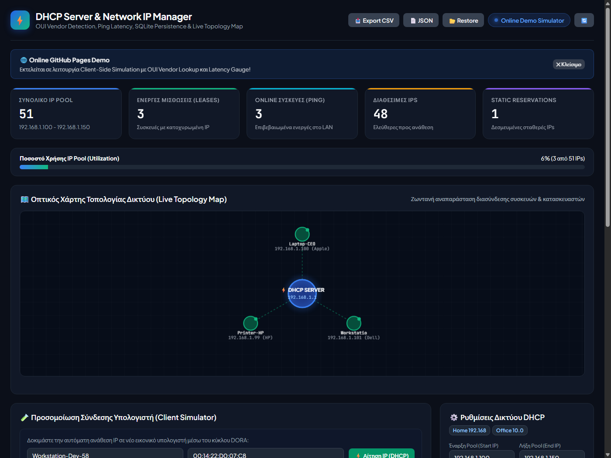
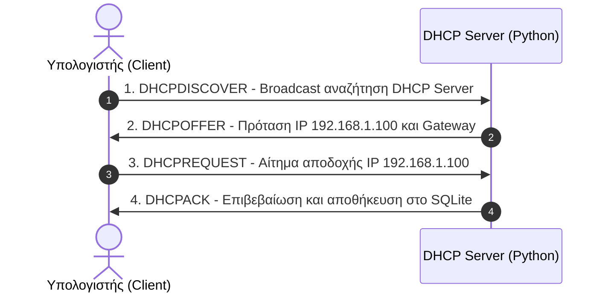

# 🌐 DHCP Server & Network IP Manager

[](https://karidasd.github.io/dhcp-network-manager/)
[](https://github.com/karidasd/dhcp-network-manager/actions/workflows/test.yml)
[](https://www.python.org/)
[](https://www.sqlite.org/)
[](#)

Ένα πλήρες, σύγχρονο σύστημα αυτόματης απόδοσης και διαχείρισης διευθύνσεων IP (**DHCP Server**) για υπολογιστές και συσκευές τοπικού δικτύου (LAN), γραμμένο σε **Python** με **SQLite Persistence**, **OUI Vendor Detection (Αναγνώριση Κατασκευαστή)**, **Ping Latency (ms)**, **Rogue Device Security Detection** και **Διαδραστικό Οπτικό Χάρτη Τοπολογίας (Topology Map)**.

👉 **Δοκιμάστε το άμεσα Online (Live Demo):** **[https://karidasd.github.io/dhcp-network-manager/](https://karidasd.github.io/dhcp-network-manager/)**

---

<p align="center">
  <a href="https://karidasd.github.io/dhcp-network-manager/">
    
  </a>
</p>

---

## 🚀 Πώς να το ξεκινήσετε Τοπικά (Quick Start)

### Τρόπος 1: Με διπλό κλικ (Windows)
Κάντε διπλό κλικ στο αρχείο **`start.bat`**.
Αυτό θα ξεκινήσει αυτόματα τον server και θα ανοίξει το Web Dashboard στον browser σας στη διεύθυνση:
👉 **`http://localhost:8080`**

### Τρόπος 2: Μέσω τερματικού / PowerShell
```bash
cd DHCP_Server
py server.py
# Ή σε Linux/macOS: python3 server.py
```

> **Zero Dependencies:** Δεν χρειάζεται καμία εξωτερική βιβλιοθήκη με `pip`! Χρησιμοποιεί αποκλειστικά τη στάνταρ βιβλιοθήκη της Python (`http.server`, `socket`, `sqlite3`, `threading`).

---

## 🎯 Δυνατότητες & Χαρακτηριστικά

### 1. 🌐 Dual-Mode Λειτουργία (Online & Local)
- **Online στο GitHub Pages:** Λειτουργεί αυτόνομα με in-browser client-side simulator engine, επιτρέποντας σε οποιονδήποτε να δοκιμάσει το DORA, την απόδοση IP, τον χάρτη τοπολογίας και τις εξαγωγές απευθείας στον browser.
- **Τοπικά με Python & SQLite:** Συνδέεται με τον τοπικό DHCP daemon, αποθηκεύει τα πάντα στη βάση `dhcp_leases.db` και επιτρέπει broadcast UDP 67 network listening.

### 2. ⚡ Αυτόματη Απόδοση IP (DHCP Protocol)
- Πλήρης υλοποίηση του κύκλου **DORA** (**D**iscover ➔ **O**ffer ➔ **R**equest ➔ **A**cknowledge).
- Αυτόματος έλεγχος διαθεσιμότητας και αποφυγή διπλότυπων IP διευθύνσεων.
- Παρακολούθηση διάρκειας μίσθωσης (Lease Duration) και αυτόματη λήξη/ανανέωση.

### 3. 🏷️ OUI Vendor Detection (Αναγνώριση Κατασκευαστή)
- Αυτόματη αναγνώριση του κατασκευαστή υλικού βάσει του MAC address prefix (Apple, Dell, Intel, HP, Samsung, Raspberry Pi, Cisco, Espressif IoT, TP-Link, Xiaomi κ.α.).

### 4. 💾 Μόνιμη Αποθήκευση Δεδομένων (SQLite Persistence)
- Όλες οι ενεργές μισθώσεις, οι στατικές κρατήσεις και οι ρυθμίσεις δικτύου αποθηκεύονται αυτόματα στην τοπική βάση **`dhcp_leases.db`**.
- Ακόμα και αν κλείσει ο server, τα δεδομένα παραμένουν ασφαλή και ανακτώνται κατά την επανεκκίνηση.

### 5. 🗺️ Διαδραστικός Οπτικός Χάρτης Δικτύου (Live Topology Map)
- Dynamic HTML5 Canvas rendering της τοπολογίας του τοπικού δικτύου.
- Κεντρικός κόμβος (DHCP Gateway) συνδεδεμένος με όλες τις ενεργές συσκευές σε πραγματικό χρόνο.
- Οπτική ένδειξη κατάστασης σύνδεσης, IP και κατασκευαστή.

### 6. 🟢 Ζωντανός Έλεγχος Συσκευών (Ping & Latency in ms)
- Αυτόματο background scanning μέσω ICMP Ping.
- Ένδειξη **Online (πράσινο)** / **Offline (γκρι)** και μέτρηση καθυστέρησης (latency ms) για κάθε συνδεδεμένη συσκευή.

### 7. 🛡️ Ασφάλεια & Ειδοποιήσεις (Rogue Device & Webhook Alerts)
- **Rogue Device Detection:** Εντοπίζει και ειδοποιεί άμεσα στο UI όταν μια άγνωστη MAC address εμφανιστεί στο δίκτυο.
- **Discord / Webhook Alerts:** Δυνατότητα αποστολής αυτόματης ειδοποίησης σε κανάλι Discord/Slack/Telegram.
- **Pool Exhaustion Warning:** Προειδοποίηση όταν η χρήση του εύρους IP ξεπεράσει το 85%.

### 8. 📊 Εξαγωγή & Επαναφορά Αναφορών (CSV & JSON Backup/Restore)
- Άμεση εξαγωγή όλων των leases και των συσκευών σε αρχείο Excel/CSV (`/api/export/csv`).
- Πλήρες JSON backup και **Restore** με ένα κλικ.

### 9. 🔒 Στατικές Δεσμεύσεις (Static Reservations / IP Binding)
- Δέσμευση συγκεκριμένης IP για συγκεκριμένη MAC διεύθυνση (π.χ. Server, NAS, Εκτυπωτής).

### 10. 📡 Πραγματικό Δίκτυο (UDP Port 67)
- Περιλαμβάνει UDP socket listener για πραγματικά broadcast πακέτα DHCP (RFC 2131) όταν εκτελείται με δικαιώματα διαχειριστή.

---

## 🧠 Πώς λειτουργεί το Πρωτόκολλο DHCP (DORA);



---

## 📁 Δομή Αρχείων

```
DHCP_Server/
│
├── .github/
│   └── workflows/
│       └── test.yml         <- GitHub Actions CI Pipeline
│
├── dashboard-preview.png    <- Screenshot προεπισκόπησης Dashboard
├── index.html               <- Live GitHub Pages Dashboard
├── start.bat                <- Εκκινητής Windows (Double-click)
├── server.py                <- HTTP API Server & Web Controller
├── dhcp_engine.py           <- Κύριος πυρήνας διανομής IP & DORA engine
├── db_manager.py            <- Διαχειριστής βάσης δεδομένων SQLite 3
├── test_dhcp.py             <- Αυτοματοποιημένα τεστ επαλήθευσης
├── README.md                <- Τεκμηρίωση & οδηγός χρήσης
├── .gitignore               <- Εξαιρέσεις Git (db, pycache κ.α.)
│
└── web/
    └── index.html           <- Τοπικό Web Dashboard
```
